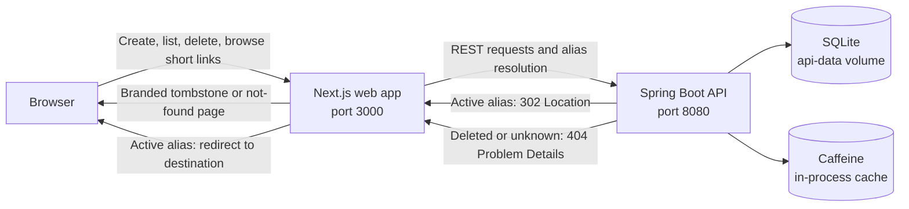

# A little less link.

A small, self-hostable URL shortener. Create a memorable alias, copy and share the short link, then manage your active links from one place. Deleted links keep a tombstone, so an old shared URL explains what happened instead of silently pointing somewhere else.

**Spring Boot 4 · Java 21 · Next.js 16 · TypeScript · SQLite · OpenAPI**

## What it does

- Creates short links with generated aliases or your own custom alias.
- Checks custom aliases and destinations, and returns useful field-level errors.
- Lists active links with pagination, a total result count, and one-click deletion.
- Keeps deleted aliases reserved and shows a clear tombstone page to visitors.
- Serves browser-facing resolution pages from the web app while the API stays RESTful.
- Stores data in SQLite and caches known link states in a bounded Caffeine cache.

Aliases are case-insensitive. Generated aliases are eight lowercase letters or digits. Custom aliases can contain 3–16 ASCII letters, numbers, or hyphens. Aliases are never reused, even after deletion.

## Start the app

You’ll need Docker Engine or Docker Desktop with the Compose plugin.

```sh
docker compose up --build
```

Open the app at <http://localhost:3000>. The API is available at <http://localhost:8080> and its health endpoint is <http://localhost:8080/actuator/health>.

The Compose setup persists SQLite data in the `api-data` volume. Stop the services with `Ctrl+C`, or run:

```sh
docker compose down
```

To remove the database volume too, run `docker compose down -v`. **This permanently deletes the saved links.**

## Declarative development environment

The repository uses [mise](https://mise.jdx.dev/) to declare its local Java and Node.js toolchains in `mise.toml`. Install mise using its [installation guide](https://mise.jdx.dev/getting-started.html), then from the repository root run:

```sh
mise install
mise run setup
```

This installs Temurin Java 21, Node.js 22.12.0, and the frontend dependencies. Docker is required for the Compose stack and is managed separately by Docker Desktop or Docker Engine.

Run the API and frontend in separate terminals with `mise run api` and `mise run web`. Use `mise run stack` to build and run both services with Docker Compose. Common checks are available as `mise run test-api` and `mise run test-web`.

## How it fits together

The UI and API are separate applications. The browser talks to the Next.js app; its server routes proxy create, list, and delete requests to the Spring Boot API. Short links use the web app’s public origin. For a browser visit, the web app asks the API to resolve the alias, forwards active-link redirects, and renders the deleted or not-found page itself.



The API caches known active and deleted aliases for up to 60 seconds, with a 10,000-entry limit. Unknown aliases are not cached. The cache is local to each API process. A lookup racing with deletion can briefly repopulate an active result after deletion evicts it; that result can remain until its cache entry expires.

See the [Azure hosting proposal](./docs/architecture/azure-hosting.md) for a production deployment design using Application Gateway, containerized App Services, Azure SQL, private networking, and Azure Monitor.

## Use the API

The API contract lives in [`openapi.yaml`](./openapi.yaml). Create a link with a custom alias:

```sh
curl -i http://localhost:8080/shorten \
  -H 'Content-Type: application/json' \
  -d '{"fullUrl":"https://example.com/reports/quarterly","customAlias":"quarterly-report"}'
```

The `201 Created` response contains a `shortUrl`, such as `http://localhost:3000/quarterly-report`. Omit `customAlias` to have the API generate one.

| Operation | Endpoint | Result |
|---|---|---|
| Create a short link | `POST /shorten` | `201 Created` with the short URL |
| List active links | `GET /urls` | `200 OK` with the active link collection |
| Resolve an active alias | `GET /{alias}` | `302 Found` with the destination in `Location` |
| Delete an active alias | `DELETE /{alias}` | `204 No Content` |
| Check API health | `GET /actuator/health` | `200 OK` when healthy |

The UI paginates the link list in groups of 20 at its server boundary; the API’s `GET /urls` contract remains an unpaginated collection. API errors use `application/problem+json` with stable problem types. A deleted or unknown alias returns `404` from the API; the web app turns those responses into the appropriate browser page.

## Configuration

| Variable | Used by | Default | Purpose |
|---|---|---|---|
| `SHORT_URL_BASE_URL` | API | `http://localhost:3000` | Public origin used when returning created short links. Set this to the reachable web origin when hosting elsewhere. |
| `API_BASE_URL` | Web app | `http://localhost:8080` | API origin used by the web server. Compose sets it to `http://api:8080` inside the container network. |
| `DATABASE_URL` | API | `jdbc:sqlite:urlshortener.db` | JDBC URL for SQLite. Compose uses `/data/urlshortener.db` in the persistent volume. |

For a local development setup, run the API and web app in separate terminals:

```sh
cd api && ./gradlew bootRun
```

```sh
cd web && npm ci && API_BASE_URL=http://localhost:8080 npm run dev
```

The web client is generated from `openapi.yaml` before development and production builds.

## Develop and validate

Requirements: Java 21 and Node.js 22.12 or newer.

```sh
# API formatting, OpenAPI validation, and API tests
cd api && ./gradlew spotlessCheck test

# Frontend tests, lint, and TypeScript checks
cd web && npm test && npm run lint && npm run typecheck

# Frontend tests with coverage (excludes generated OpenAPI types)
cd web && npm run test:coverage

# Browser end-to-end tests (requires Docker Compose and Chromium)
cd web && npx playwright install chromium && npm run test:e2e
```

The HTML coverage report is written to `web/coverage/index.html`.
Playwright starts an isolated Compose project on ports 13000 and 18080, then removes its containers and database volume when the suite finishes.

Regenerate the Java API interfaces and models with `cd api && ./gradlew openApiGenerate`. Generate the TypeScript client with `cd web && npm run api:generate`. Generated files live under `api/build/generated/openapi/` and `web/src/generated/`; edit the OpenAPI source rather than generated output.

Install the repository’s Git hooks in a fresh clone with:

```sh
./.agents/skills/repo-setup/scripts/install-git-hooks.sh
```

## Project structure

```text
api/                 Spring Boot API, persistence, and API tests
web/                 Next.js UI, server routes, and frontend tests
openapi.yaml         Source of truth for the REST contract
docs/adr/            Accepted architecture decisions
docs/features/       Feature specifications and implementation plans
docs/agentic-development.md  How specs, plans, instructions, and skills fit together
compose.yaml         Local multi-service environment
```

I included the feature specs and implementation plans to demonstrate one way I use AI to generate code consistently and keep the work traceable. This is an example of my workflow, not the only way I work.
