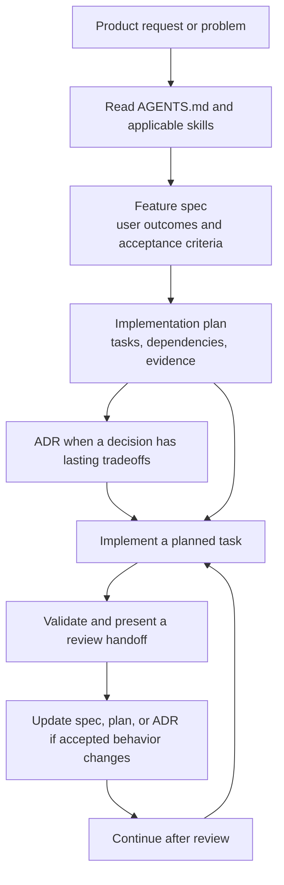

# Agentic development in this repository

This repository keeps product intent, implementation work, and durable technical decisions in separate artifacts. They give people and coding agents the same context, help keep changes traceable, and make it easier to resume work without relying on chat history.

## The artifacts

| Artifact | Location | Purpose |
|---|---|---|
| Repository instructions | [`AGENTS.md`](../AGENTS.md) | Always-on project rules for structure, commands, generated code, testing, commits, and security. Read these before changing code. |
| Agent skills | [`.agents/skills/`](../.agents/skills/) | Reusable task workflows. Each skill has a `SKILL.md` describing when it applies and the steps to follow. |
| Feature specifications | [`docs/features/`](./features/) | User needs, scope, acceptance criteria, and behavior examples. They describe what the product should do. |
| Implementation plans | [`docs/features/`](./features/) | Sequenced tasks, dependencies, implementation areas, and completion evidence. They describe how the agreed behavior will be delivered. |
| Architecture Decision Records (ADRs) | [`docs/adr/`](./adr/) | Accepted technical decisions, alternatives, and lasting tradeoffs. They explain why the system is shaped as it is. |
| API contract | [`openapi.yaml`](../openapi.yaml) | Source of truth for REST endpoints, request and response schemas, and status codes. Generated Java and TypeScript files come from this contract. |

`AGENTS.md` and skills guide the work. Specs and plans describe a feature. ADRs record consequential decisions. The OpenAPI document defines the API boundary. These artifacts complement each other; none should quietly replace or contradict another.

## How they fit together

For work that spans discovery through full-stack delivery, use the repository's [spec-driven development skill](../.agents/skills/spec-driven-development/SKILL.md). Isolated bug fixes and routine edits can proceed directly under `AGENTS.md` without creating a full feature package.



The ADR is conditional: create one when a choice affects architecture or creates a meaningful long-term tradeoff. Do not create ADRs for routine implementation details.

## Working with feature specs and plans

Create feature artifacts under `docs/features/<feature-name>/`:

```text
docs/features/<feature-name>/
  spec.md
  plan.md
```

Keep the specification focused on user-visible behavior. Include the audience or scenario, goals, scope, acceptance criteria, and useful behavior examples. Keep class names, endpoint implementation details, and task sequencing in the plan.

Break the plan into small, reviewable tasks. For each task, state its outcome, dependencies, area of work, and how completion will be checked. Keep the plan aligned with the accepted spec as work progresses. If a requirement changes, update the spec first and then revise the dependent plan and implementation.

The spec-driven skill calls for a review handoff after each planned task. The handoff should summarize the behavior delivered, files changed, criteria covered, validation, and unresolved risks. Continue after the user reviews the task; use a Conventional Commit when that task is approved.

## Recording architecture decisions

Add an ADR under `docs/adr/` when a decision has meaningful alternatives or consequences beyond one small change. Follow the existing numbered naming pattern and include:

- status and date;
- context and constraints;
- the selected decision;
- alternatives considered;
- consequences and tradeoffs.

Use an accepted ADR as the durable record of the decision. When implementation later changes the decision, update the ADR and any feature plans that rely on it. Keep API contract decisions consistent with `openapi.yaml` and the generated clients.

## Repository skills

Skills live in `.agents/skills/<skill-name>/SKILL.md`. The skill catalog in the development environment determines which workflows are available; this repository currently includes:

- **spec-driven-development** — full-stack feature discovery, specification, planning, implementation, and review handoffs;
- **repo-setup** — fresh-checkout setup, Git hooks, and Docker Compose startup.

Use a skill when its stated scope matches the task. Read its `SKILL.md` before following the workflow, including any referenced templates or supporting files. A skill supplies process guidance; it does not override the user's accepted product requirements or the API contract.

## Generated API code

Treat `openapi.yaml` as the editable contract. Regenerate API artifacts with `cd api && ./gradlew openApiGenerate`, and regenerate the web client with `cd web && npm run api:generate`. Do not hand-edit files under `web/src/generated/` or Gradle's generated output. When endpoint behavior changes, keep the OpenAPI definition, API implementation, generated client, and feature documentation aligned.
