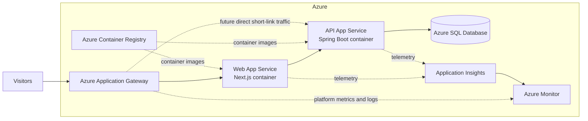

# How I’d host and scale this in Azure

I’d keep the current split between the Next.js UI and Spring Boot API, run both as Docker containers in Azure App Service, and put Azure Application Gateway in front of them. I’d use Azure SQL for persistent data, with Application Insights and Azure Monitor for observability.

## Sketch

I’d keep the UI, API, and database within the Azure network, with the gateway as the public entry point. The details of subnet layout and private connectivity can be worked out as part of provisioning; they aren’t the main architectural decisions I want to capture here.

## How I’d scale it

I’d move from SQLite to Azure SQL before running multiple API instances. Today SQLite is a local file, so replicas need a shared database first. That change also needs SQL Server driver and dialect support in the API, schema compatibility work, and a migration of existing links and tombstones. Changing the connection string alone won’t be enough.

Before horizontal API scaling, I’d replace the process-local Caffeine cache with a shared cache, or remove the cache and see whether Azure SQL can handle the load. With multiple instances, each local cache can disagree about an alias, and a delete on one instance won’t invalidate another instance’s entry. The database should remain the source of truth. I’d pay particular attention to cache invalidation after deletion.

I’d also move link-list pagination from the Next.js BFF into the API and database. The BFF currently fetches the full link collection and slices it into pages of 20. That was sufficient with the current contract and expected data size; as the list grows, it means every page request still moves and processes the whole collection. I’d add pagination parameters and metadata to the API contract, use a stable database sort, and regenerate the API clients.

Generated aliases are eight random lowercase letters or digits, not hash-derived. The API already retries collisions and records collision and success counters. I’d watch those metrics as the number of links grows; if collisions become material, I’d increase the alias space or change the generation approach. A hash-derived scheme would need its own collision and privacy analysis. See [ADR 0002](../adr/0002-random-generated-aliases.md).

## Link resolution

The API owns alias lookup and returns a redirect for an active link, but browser requests currently reach the Next.js `[alias]` route first. The UI asks the API to resolve the alias, forwards the redirect, and renders branded pages for deleted and unknown links. I chose that flow so the app has the same user experience in Compose and other non-Azure environments, without relying on Azure-specific routing.

If resolution traffic became significant, I’d consider a separate short-link hostname routed by Application Gateway directly to the API. That would remove the extra UI hop for each click and keep resolution traffic off the web app. I’d first decide how deleted and unknown links should look in a browser: the API currently returns Problem Details for those cases, while the UI renders friendly pages. If I wanted the same experience in every environment, I’d keep resolution in the UI; if I changed the Azure route, I’d define the fallback behavior as part of that change.

## Later options

If read traffic outgrows the API and database design, I’d consider CQRS or a separate read model. If a single Azure SQL database became a measured capacity limit, I’d investigate sharding. Both would add substantial complexity, so I’d revisit them only after simpler scaling and query improvements stopped meeting the need.

For observability, I’d use Application Insights to follow requests through the UI and API, and Azure Monitor to review platform metrics, logs, and alerts. I’d scale the App Services and database in response to what that telemetry shows.

This describes a possible direction; the repository currently runs on SQLite and does not include Azure deployment resources.
