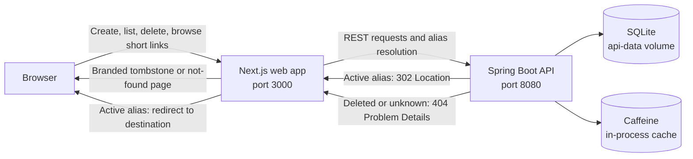

# Architecture overview

The UI and API are separate applications. The browser talks to the Next.js app; its server routes proxy create, list, and delete requests to the Spring Boot API. Short links use the web app’s public origin. For a browser visit, the web app asks the API to resolve the alias, forwards active-link redirects, and renders the deleted or not-found page itself.

The API controllers follow the three OpenAPI groups: creation, URL listing/deletion, and redirects. Controllers map request and response models and choose HTTP responses. The short-link service owns validation rules, alias allocation, listing order, deletion, and resolution; it returns domain data and raises domain exceptions. `ApiProblemHandler` maps those exceptions to the shared Problem Details responses, keeping HTTP statuses and generated API models out of the service layer.

Frontend routes share backend configuration, timeouts, and Problem Details handling through `web/src/server/`. The resolution adapter isolates the existing API's title-based distinction between deleted and unknown links; the OpenAPI contract is unchanged. Browser requests and UI state live in `web/src/features/short-links/`, with explicit list refresh after creation and deletion. React pages and standalone resolution responses use the same base stylesheet in `web/public/styles/shared.css`.

## Code map

| Area | Location |
|---|---|
| API HTTP controllers and error mapping | [`api/.../api/`](../../api/src/main/java/com/tpximpact/urlshortener/api/) |
| Link rules, domain results, and alias generation | [`api/.../shortlink/`](../../api/src/main/java/com/tpximpact/urlshortener/shortlink/) |
| Database repository | [`api/.../persistence/`](../../api/src/main/java/com/tpximpact/urlshortener/persistence/) |
| Frontend routes and UI components | [`web/src/app/`](../../web/src/app/) |
| Browser API calls and state hooks | [`web/src/features/short-links/`](../../web/src/features/short-links/) |
| Server-only API adapters | [`web/src/server/`](../../web/src/server/) |
| Shared base and resolution-page styles | [`web/public/styles/`](../../web/public/styles/) |

## Related documentation

- [Architecture decisions](../adr/) explain the decisions and tradeoffs, including caching, deletion consistency, pagination, and browser resolution pages.
- [API usage and contract](../api.md) describe the available operations.
- [Configuration](../configuration.md) covers runtime settings and optional OTLP metrics export.
- [Azure hosting proposal](azure-hosting.md) describes a possible deployment and scaling direction; Azure infrastructure is not included in this repository.
